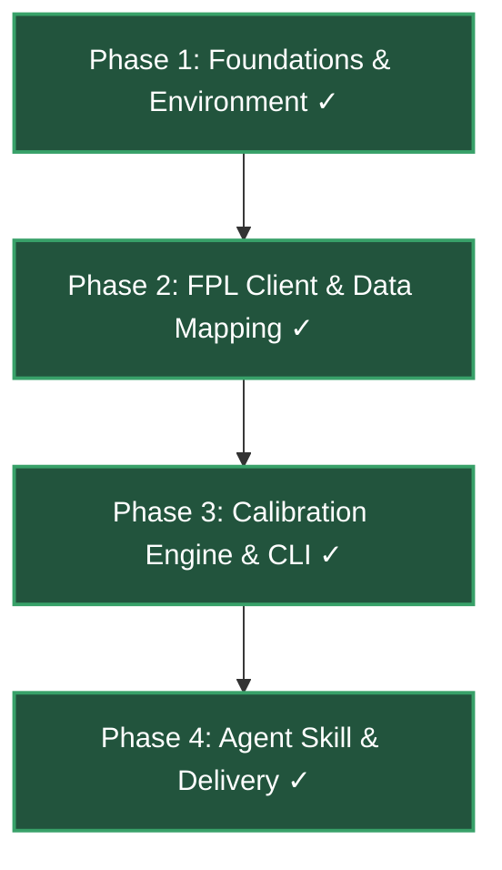

# jubilee-solio-calibrate - Project Roadmap

This roadmap tracks the development progress, target architecture, and phases for **jubilee-solio-calibrate**.

> **Agents:** read [`docs/agents/current-state.md`](docs/agents/current-state.md) first for what is built today vs this plan.

---

## Personas

| Persona | Goal | Primary surface |
|---------|------|-----------------|
| **FPL Manager** | Calibrate Solio team strengths and export upload-ready CSV | CLI / Agent skill |
| **Developer** | Maintain FPL client, calibration heuristics, and test suite | Python / Pytest |

---

## Current Project Status: **Complete (All Phases Delivered)**

---

## Implementation Phases

### ⏳ Phase 1: Repo Infrastructure & Foundations (Done)

- [x] Initialize Python package config (`pyproject.toml`) with uv, httpx, pandas, pytest, and ruff.
- [x] Wire delivery gate project test command (`tests/project-tests.sh` or `.azg/project-test-cmd`).
- [x] Scaffold folder layout: `src/solio_calibrate/`, `data/`, `tests/`, `.agents/skills/solio-calibrate/`.
- [x] Add raw example data from Solio export to `data/raw/team_strengths.csv`.

---

### ⏳ Phase 2: FPL API Client & Data Mapping (Done)

- [x] Implement bidirectional team code mapping (`ARS`, `MCI`, etc.) to FPL IDs.
- [x] Implement FPL API client for `bootstrap-static` and fixture data with local JSON caching.
- [x] Implement Solio CSV schema loader and validator (`Team,Goals,Goals Conceded`).

---

### ⏳ Phase 3: Calibration Engine & CLI (Done)

- [x] Implement pure calibration mathematical adjustment logic (form, fixture difficulty, user multipliers).
- [x] Implement CLI tool (`solio-calibrate`) with arguments for input file, output file, and adjustment parameters.
- [x] Add unit test suite for mapping, CSV I/O round-tripping, and calibration math.

---

### ⏳ Phase 4: Agent Skill & Delivery (Done)

- [x] Author agent skill `.agents/skills/calibrate-team-strength/SKILL.md` for interactive execution.
- [x] End-to-end calibration run and sample output verification in Solio-compatible format.
- [x] Run full project gate `bash tests/verify.sh`. 

---

> [!NOTE]
> **Pre-commit gate:** run all test and lint commands successfully before proposing commits.
